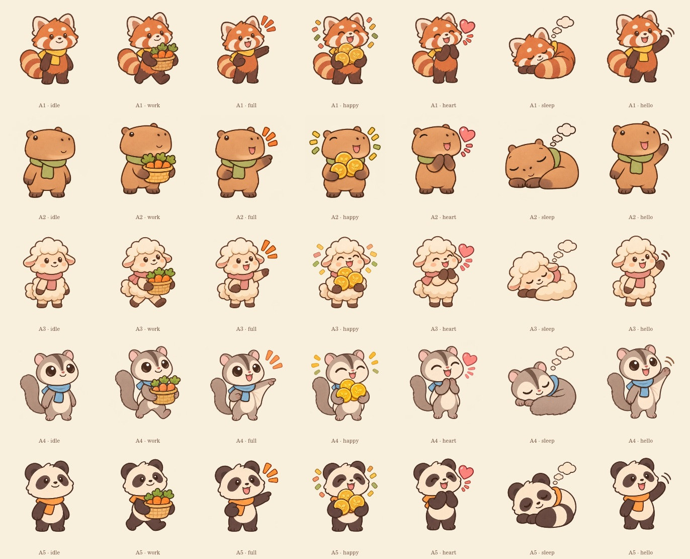

# 동물 농장 리소스 · 1105

PC에서 아래 링크를 눌러 ZIP을 저장하세요. 비공개 저장소라면 GitHub 로그인이 필요합니다.

- [전체 리소스 ZIP 다운로드 · 23.3MB](https://github.com/Seain17/Winedb/raw/refs/heads/codex/animal-farm-resources-1105/deliveries/animal-farm-1105/animal-farm-resources-1105.zip)
- [우선 적용팩 다운로드 · 8.6MB](https://github.com/Seain17/Winedb/raw/refs/heads/codex/animal-farm-resources-1105/deliveries/animal-farm-1105/animal-farm-priority-1105.zip)

전체 ZIP을 압축 해제한 뒤 `animal-farm-1105/preview.html`을 브라우저에서 열면 모든 리소스와 위젯 움직임을 볼 수 있습니다.

필수 PNG 78개: 동물 5종 × 7포즈, 낮·밤 배경, 아이콘, 배너, 연출, 위젯 프레임, 브랜드 없는 교환소 카테고리, 앱 아이콘. 슬롯 ID·규격은 `asset-manifest.json`에 있습니다. 선택 항목 LV2/LV3 배경은 포함하지 않았습니다.

지정 크기·투명도·8% 여백·위젯 변화 영역 검사와 ZIP 무결성 검사를 통과했습니다.

전체 ZIP SHA-256: `f3bef411605b00cf3148021ccdcfef98d706a94712c3b2f097defd4561f42522`

