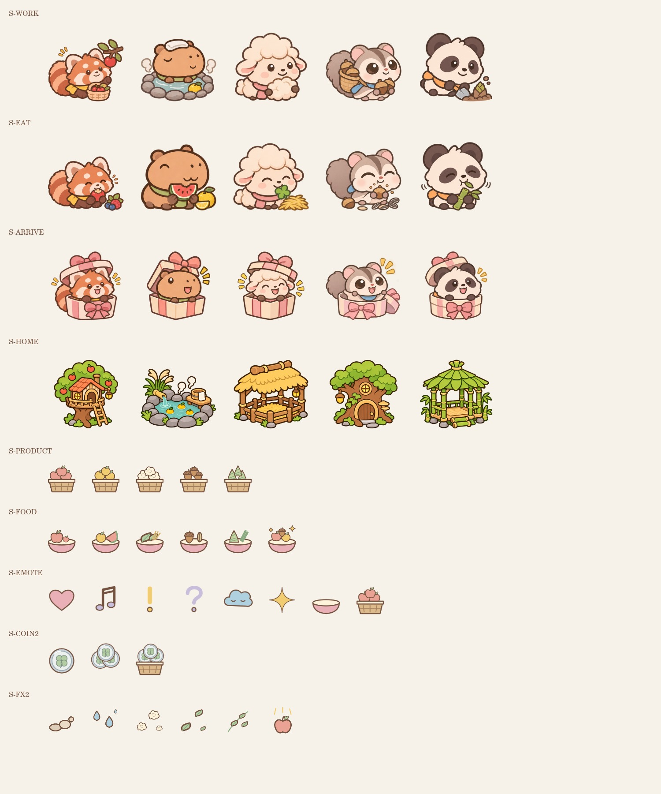
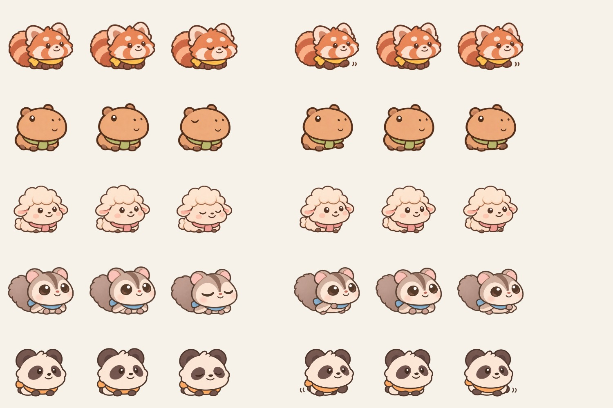

# 동물 농장 2차 리소스 · 1106

머리는 크게, 몸통은 둥글게, 팔다리는 짧게 수정한 아기 동물 버전입니다. 레서판다·카피바라·양·하늘다람쥐·아기판다의 작업, 먹기, 합류, 걷기, 위젯 포즈에 적용했습니다.

**[2차 ZIP 다운로드](https://github.com/Seain17/Winedb/raw/refs/heads/codex/animal-farm-resources-1106/deliveries/animal-farm-1106/animal-farm_2%EC%B0%A8_1106.zip)**

위 링크가 바로 저장되지 않으면 이 폴더의 ZIP 파일을 연 뒤 GitHub의 **Download raw file** 버튼을 누르세요. 비공개 저장소는 GitHub 로그인이 필요합니다.

압축을 풀고 `animal-farm_2차_1106/preview.html`을 브라우저에서 열면 전체 시트와 걷기·위젯 애니메이션을 볼 수 있습니다.

- 필수 13종, 완성 PNG 15장. 선택 계절 배경은 제외했습니다.
- 동물 순서: A1 레서판다 → A2 카피바라 → A3 양 → A4 하늘다람쥐 → A5 아기판다.
- `atlas-map.json`: 크기·칸 순서·잘라 쓸 좌표·SHA-256.
- `verification.txt`: 크기·투명 여백·배경 안전 영역 검사 결과.
- 성장 배경 2장은 1차 배경의 중앙 동물 배치 공간(y 38~66%)을 그대로 유지합니다.

