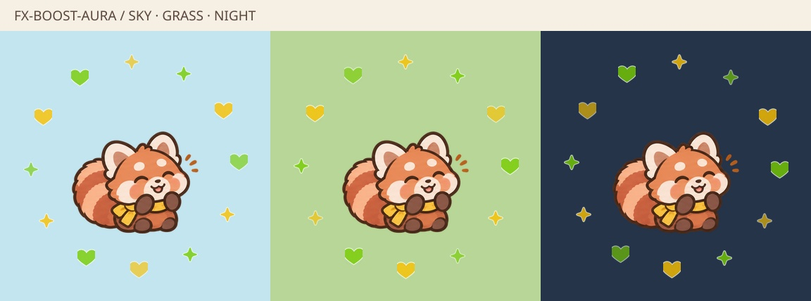
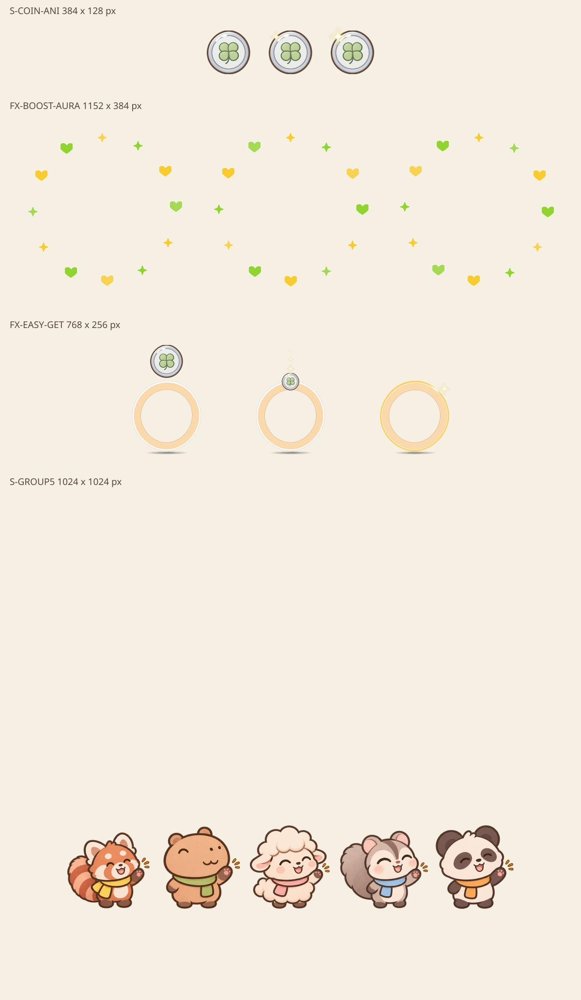

# 동물 농장 연출 수정본 · 1117-2

재요청된 **4종을 수정**했습니다. 나머지 **12종 PNG는 11-17 납품본과 바이트 단위로 동일**합니다.

**[수정 4종 ZIP](https://github.com/Seain17/Winedb/raw/refs/heads/codex/animal-farm-resources-1117-2/deliveries/animal-farm-1117-2/animal-farm-revised4-1117-2.zip)** · **[전체 16종 ZIP](https://github.com/Seain17/Winedb/raw/refs/heads/codex/animal-farm-resources-1117-2/deliveries/animal-farm-1117-2/animal-farm-effects-1117-2.zip)**

수정 4종 ZIP은 교체할 PNG 네 장만 포함합니다. 전체 ZIP에는 16종 PNG, 프레임 좌표 JSON, 오프라인 재생 미리보기와 검사 결과가 포함됩니다. `preview.html`은 압축을 푼 뒤 브라우저로 열어 확인하세요.

| 시트 | 규격 | 수정 내용 |
|---|---|---|
| S-COIN-ANI | 128 × 3칸 / 384×128 | 바구니 없이 은색 클로버 코인 한 개. FX-COIN-FLY 정면 원본 사용. 기본 → 작은 반짝임 → 큰 반짝임 |
| FX-BOOST-AURA | 384 × 3칸 / 1152×384 | 노랑·연두 별과 하트, 흰 테두리. 중앙 60% 지름은 완전 투명. 위치를 조금씩 회전시키고 밝기를 바꿈 |
| FX-EASY-GET | 256 × 3칸 / 768×256 | 크림색 원형 테두리·흰 외곽선·아래 그림자. 코인 대기 → 축소·하강과 반짝 꼬리 → 노란 테두리와 십자형 반짝임 |
| S-GROUP5 | 1024 × 1칸 / 1024×1024 | 그림 폭 922px(90.04%). 아래쪽에 배치, 위쪽 글자 자리 확보. 기존 다섯 동물의 손 흔드는 포즈와 색 유지 |

## 적용 안내

모든 프레임은 정사각형 칸을 가로로 연결했습니다. 0부터 시작하는 프레임 `i`는 `(i × 칸 크기, 0, 칸 크기, 칸 크기)`로 잘라 사용합니다. 여백은 각 칸 안에 포함되므로 별도 간격을 좌표에 더하지 않습니다. 프레임을 자동 트리밍하지 마세요.

- **S-COIN-ANI**: 코인은 90×90px, 모든 칸의 `(19,19)`에 고정했습니다. 칸 너비의 70.31%입니다. 원본 코인 픽셀은 동일하며 왼쪽 위 빛 오버레이만 달라집니다.
- **FX-BOOST-AURA**: 기존 최대 알파 83에서 204로 약 2.46배 높였습니다. 전체 화면 밝기의 배율을 뜻하지는 않습니다. 입자마다 밝기가 교차하며 조금씩 회전합니다. 권장 반복 순서는 **1→2→3→2**이고, `atlas-map.json`에는 0부터 시작하는 `[0,1,2,1]`로 적었습니다. 중앙 지름 60%는 모든 프레임에서 알파 0입니다.
- **FX-EASY-GET**: 버블 중심은 각 칸의 `(128,166)`이며 동물 얼굴을 넣을 중앙 반지름 48px 영역은 완전 투명합니다. 앱의 얼굴 그림은 이 중심에 맞춰 겹쳐 주세요. 세 번째 칸의 작은 십자형 반짝임은 그림이며 텍스트 글리프는 없습니다. 단발 재생 후 효과를 숨겨 주세요.
- **S-GROUP5**: 그림은 x=51~972, y=687~859에 배치했습니다. A1 레서판다(노랑) → A2 카피바라(초록) → A3 양(분홍) → A4 하늘다람쥐(하늘) → A5 아기판다(주황) 순서입니다. 원본 정사각형을 그대로 표시하며, 미리보기에서도 큰 폭으로 확인할 수 있습니다.

## 포함 파일과 확인 범위

- `sheets/`: 최종 투명 RGBA PNG 16장.
- `atlas-map.json`: 규격·프레임 좌표·재생 간격·알파 경계·SHA-256.
- `preview.html`: 프레임 재생, 슬라이더, 밝은 하늘·초록 들판·밤 배경 비교.
- `revisions-preview.jpg`: 수정 4종 전체 시트 확인용.
- `aura-background-check.jpg`: 동물 뒤/둘레에 오라를 겹친 배경별 확인용. 동물과 배경은 오라 원본에 포함되지 않습니다.
- `verification.txt`: 크기·투명 여백·중앙 투명 영역·코인 고정·기존 12종 동일성·미리보기 검사 결과.
- `SHA256SUMS.txt`: 파일 무결성 확인값.

원본 PNG에는 글자·숫자·워터마크가 없습니다. 기존 은색 클로버 코인 도안을 유지했습니다. 파일과 미리보기를 확인했으며, 실제 앱의 좌표·레이어·재생 타이밍 결합은 앱에서 확인해야 합니다.

