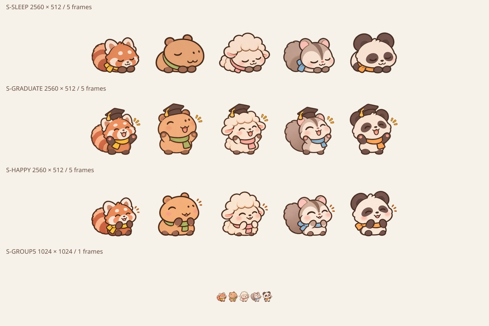
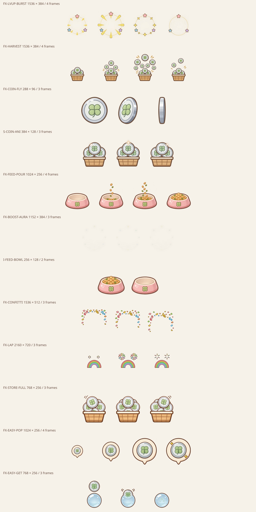

# 동물 농장 연출 리소스 · 11-17

요청된 **16종 PNG 시트, 총 55칸**입니다. 2차 팩의 아기 동물·갈색 외곽선·파스텔 색상·스카프 색을 참고했습니다.

**[전체 ZIP 다운로드](https://github.com/Seain17/Winedb/raw/refs/heads/codex/animal-farm-resources-1117/deliveries/animal-farm-1117/animal-farm-effects-1117.zip)** · **[우선 3종 ZIP](https://github.com/Seain17/Winedb/raw/refs/heads/codex/animal-farm-resources-1117/deliveries/animal-farm-1117/animal-farm-priority-1117.zip)**

우선 3종 ZIP에는 S-SLEEP·S-GRADUATE·FX-LVUP-BURST가 들어 있습니다. 전체 ZIP에는 16종과 재생 미리보기가 모두 포함됩니다.

- `sheets/`: 앱에서 사용하는 투명 RGBA PNG 원본. 파일명은 요청한 시트 ID 그대로입니다.
- `preview.html`: 압축을 풀고 브라우저로 열면 프레임 재생·슬라이더·낮/밤 배경 비교를 할 수 있습니다. 외부 연결 없이 동작합니다.
- `atlas-map.json`: 각 시트의 크기, 프레임 좌표, 순서, 권장 재생 간격, SHA-256.
- `verification.txt`: 크기·알파 채널·빈 프레임·투명 여백 검사 결과.
- `characters-preview.jpg`, `effects-preview.jpg`: 전체 확인용 이미지. 미리보기의 제목은 PNG 원본에 포함되지 않습니다.

## 시트 규격

| 시트 | 칸 크기 | 칸 수 | 전체 PNG |
|---|---:|---:|---:|
| S-SLEEP | 512 | 5 | 2560 × 512 |
| S-GRADUATE | 512 | 5 | 2560 × 512 |
| FX-LVUP-BURST | 384 | 4 | 1536 × 384 |
| FX-HARVEST | 384 | 4 | 1536 × 384 |
| FX-COIN-FLY | 96 | 3 | 288 × 96 |
| S-COIN-ANI | 128 | 3 | 384 × 128 |
| FX-FEED-POUR | 256 | 4 | 1024 × 256 |
| FX-BOOST-AURA | 384 | 3 | 1152 × 384 |
| I-FEED-BOWL | 128 | 2 | 256 × 128 |
| FX-CONFETTI | 512 | 3 | 1536 × 512 |
| FX-LAP | 720 | 3 | 2160 × 720 |
| S-GROUP5 | 1024 | 1 | 1024 × 1024 |
| S-HAPPY | 512 | 5 | 2560 × 512 |
| FX-STORE-FULL | 256 | 3 | 768 × 256 |
| FX-EASY-POP | 256 | 4 | 1024 × 256 |
| FX-EASY-GET | 256 | 3 | 768 × 256 |

## 적용

모든 칸은 정사각형이며 가로로 연결됩니다. 0부터 시작하는 프레임 번호 `i`의 잘라 쓰는 좌표는 `(i × 칸 크기, 0, 칸 크기, 칸 크기)`입니다. 별도 칸 간격을 좌표에 더하지 마세요. 여백은 각 칸 안에 포함되어 있으며, 인접 그림 사이에 칸 너비의 10% 이상 투명 간격이 있습니다.

동물 순서는 **A1 레서판다(노랑) → A2 카피바라(초록) → A3 양(분홍) → A4 하늘다람쥐(하늘) → A5 아기판다(주황)**입니다. S-SLEEP·S-GRADUATE·S-HAPPY는 동물별 상태 그림이며 다섯 칸을 연속 애니메이션으로 재생하지 않습니다. S-GROUP5는 다섯 친구를 포함하는 1024px 정사각형 이미지 한 장입니다. I-FEED-BOWL의 순서는 **가득 찬 그릇 → 빈 그릇**입니다.

프레임은 동일한 캔버스와 기준점으로 조립했습니다. 바구니·그릇·버블은 바닥 기준으로 정렬했습니다. FX-EASY-POP의 크기 변화, FX-EASY-GET의 코인 이동, 수확·먹이·색종이·불꽃의 움직임은 요청된 연출입니다. 프레임을 개별 자동 트리밍하지 말고 원래 칸을 유지해 사용하세요.

FX-LVUP-BURST에는 글자·리본·명패 바탕이 없습니다. 동물 뒤에 효과를, 그 위에 동물과 앱의 레벨 문구를 배치하세요. FX-BOOST-AURA는 파일 알파를 낮춰 은은한 반짝임으로 저장했습니다. FX-CONFETTI는 중앙을 비웠으며 FX-LAP는 하단을 비워 화면 내용과 겹치지 않게 했습니다. 원본 PNG에 글자·숫자·워터마크는 없습니다. 클로버는 기존 코인 도안입니다.

권장 간격은 시작값입니다. 단발 효과 종료 후에는 해당 오버레이를 숨기고, 반복 효과는 상태가 유지되는 동안 재생하세요. 실제 앱에서의 타이밍·레이어 결합 검증은 별도로 필요합니다.

